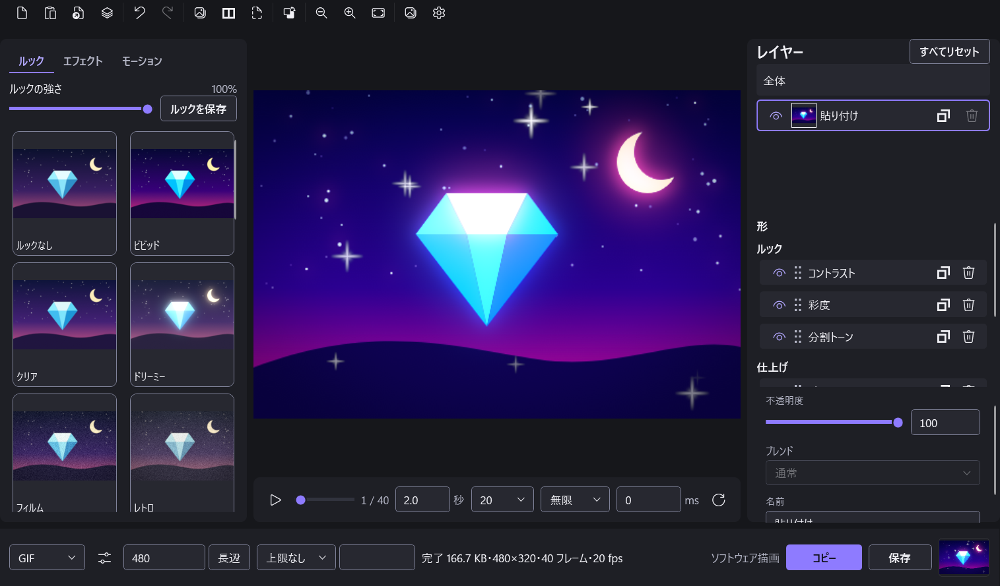
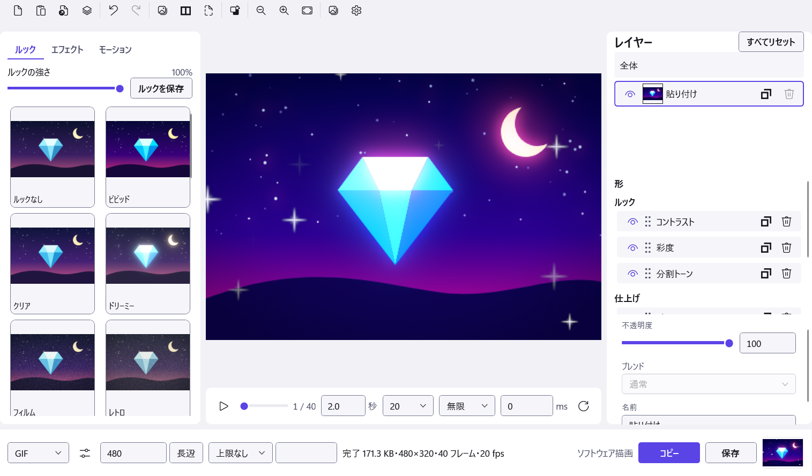

# GlintLoop

画像にエフェクトを重ねて、キラッと光る・揺れる・雪が降るような短いループ アニメーションを作る Windows 用アプリ。
できたものは GIF・APNG・WebP・PNG・JPEG で書き出し、コピー・ドラッグ・保存でそのまま渡せる。



| キラキラ | キラッ | ネオン + 雪 |
|---|---|---|
|  |  |  |

上の 3 つは、どれも同じ 1 枚の絵([source.png](docs/images/source.png))にモーションのプリセットを 1 つずつ載せて、アプリの書き出しで作った GIF(480×320・40 フレーム・20 fps)。3 つ目はルック「ネオン」も重ねている。

> **開発中(v0.6.0)。** 自動テストは通っているが、作者の PC 以外での動作確認はまだ済んでいない。

## できること

- **エフェクト 63 個**を、形・ルック・仕上げ・モーションの 4 段のスタックに積む。並べ替え・複製・オンオフ・強さの調整・Undo と Redo
- **ルック 24 個**(ビビッド・シネマ・ネオン・ドット絵・コミックなど)と、自分のルックの保存
- **モーションのプリセット 28 個**(キラキラ・キラッ・ぷくぷく・ゆらゆら・グリッチ・波紋・雪・紙吹雪など)。長さ・fps・ループ・停止時間をタイムラインで決める
- **レイヤー**: 画像を重ね、配置・拡縮・不透明度・6 種類のブレンド。レイヤーごとにスタックを持つ
- **書き出し**: GIF・APNG・WebP・PNG・JPEG。容量の上限(例: 何 MB 以内)に収まる設定を探す。GIF の色数・ディザ・差分は自作のエンコーダーで扱う
- **渡す**: 編集が止まると自動で書き出し、できたファイルをコピー・ドラッグ・保存で渡す
- **バッチ**: 同じスタックと出力設定を最大 200 個の画像にまとめて適用
- **プロジェクトファイル** `.glint`: 元の画像ごと保存して、あとで開き直せる
- 取り込み: 貼り付け・ドロップ・開く。PNG・JPEG・WebP・BMP・ICO・GIF(TIFF・HEIC・AVIF・SVG・PSD は非対応)
- 描画は Direct3D 11(GPU)。使えない環境ではソフトウェア描画(WARP)に切り替える
- ダーク・ライト・Windows に合わせる、の 3 つのテーマ。F1 でショートカットの一覧
- ネットワークは使わない



README の画面は、テストと同じ画面の外のウィンドウとソフトウェア描画で撮ったもの(右下の「ソフトウェア描画」はそのため)。

## 動作環境

- Windows 10 / 11(64 ビット)。確かめたのは Windows 11 だけ
- Direct3D 11(機能レベル 11_0 以上)の GPU。無ければソフトウェア描画で動くが遅い

## 使い方

1. [Releases](https://github.com/takosasi-dev/glintloop/releases) から `GlintLoop.exe` をダウンロードして実行する(インストール不要。.NET も同梱)
   - 署名していないので、初回は Windows SmartScreen の確認が出ることがある
2. 画像を貼り付ける(Ctrl+V)か、ウィンドウにドロップする
3. 左のギャラリーでルックやモーションを選び、右のスタックで細かく調整する
4. 下の帯で形式と大きさを決めて、「コピー」「保存」かドラッグで渡す

## ソースからビルドする

.NET 10 SDK が要る。

```
dotnet build GlintLoop.slnx -c Release
```

配布と同じ 1 ファイルの exe を作るとき:

```
dotnet publish src/GlintLoop.App/GlintLoop.App.csproj -c Release -r win-x64 --self-contained true -p:PublishSingleFile=true -p:EnableCompressionInSingleFile=true -p:DebugType=none -p:DebugSymbols=false -o publish
```

テストは自作のランナー(`tests/GlintLoop.Tests`)。ビルドのあと `tests/GlintLoop.Tests/bin/Release/net10.0-windows/GlintLoop.Tests.exe --all` で全部を走らせる。画面のテストは窓を画面の外に出すが、作業中の画面に触れたくないときは `tools/run-tests-hidden.py` で隠れたデスクトップの上で走らせる。

## 構成

| フォルダ | 中身 |
|---|---|
| `src/GlintLoop.Core` | 文書・スタック・時間のモデル、ルックとモーションのプリセット、GIF エンコーダー |
| `src/GlintLoop.Render` | Direct3D 11 の描画エンジンと、エフェクトの定義(JSON と HLSL) |
| `src/GlintLoop.Codec` | 画像の取り込みと書き出し、`.glint` |
| `src/GlintLoop.App` | WPF の画面 |
| `tests/` | 自動テスト |
| `tools/` | シェーダーのコンパイル、青色雑音のタイルの生成、測定の集計など |
| `probes/` | 測定用の小さなプログラム |

変更点は [CHANGELOG.md](CHANGELOG.md)。

## ライセンス

[MIT](LICENSE)。使っているライブラリのライセンスは [THIRD-PARTY-NOTICES.md](THIRD-PARTY-NOTICES.md) と `licenses/`。
